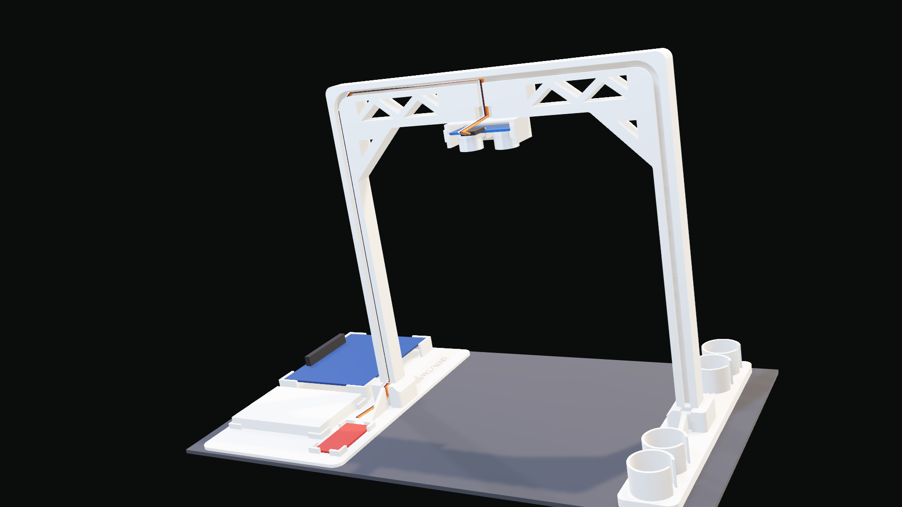

# The desk gantry: a printed MLFF gantry for the HC-SR04

A desk-sized model of a free-flow toll gantry, printed in one go on the Bambu Lab A1. It holds the
ultrasonic sensor looking straight down at the lane, carries its wires in a channel to the
roadside cabinet, and holds the DE10-Lite, the breadboard and the USB-UART in that cabinet.



## What to print (copy these to the SD card)

| File (`print/`) | What | A1 time | PLA |
| --- | --- | --- | --- |
| `LaneX_gantry_FIT_TEST_A1.gcode.3mf` | **Print this first.** The sensor pod, one post foot with its tenon, one socket | 1 h 15 min | 26 g |
| `LaneX_gantry_A1.gcode.3mf` | The whole gantry: frame, left footing, cabinet tray, one plate | 7 h 27 min | 212 g |

Both are sliced with **your own Bambu Studio settings** (taken from your traffic-light job): Bambu
Lab A1, 0.4 mm nozzle, 0.20 mm Standard, Generic PLA, **Textured PEI plate**. Changes from those
settings: no support (the design needs none), no brim, gyroid infill; frame 2 walls / 10 % infill
(light up high), footing and tray 4 walls / 40 % (heavy down low).

**On the printer:** put the SD card in, touch Print files, pick the file, check the plate is the
Textured PEI, start. Any PLA colour works; the A1 asks which spool to use.

If the printer refuses the file (it was sliced in OrcaSlicer 2.4.2, the open-source sibling of Bambu
Studio): open `LaneX_gantry_BambuStudio_project.3mf` in Bambu Studio, choose your A1 / 0.20 mm
Standard / Generic PLA, Slice, then Export plate sliced file. The STL files are there too.

## The fit test (5 minutes with the pieces)

1. **The sensor:** plug the four jumpers onto its pins first. Hold it face down (the two silver
   cans pointing down, the pins towards you) and slide it into the pod from the front. The cans run
   in the two U-slots; push until they stop at the end of the slots. The board clicks over a small
   bump at the front edge. It should sit flat and not slide out when you tilt the pod.
2. **The joint:** push the post foot's tenon into the socket and press down. It should wedge tight
   with no wobble at all, about 1 mm before the post's shoulder touches the socket top. That small
   gap is by design: it's what makes the joint play-free.

| If | Do |
| --- | --- |
| The sensor won't go in, or the cans rub | Measure the distance between the cans' centres (normally 26 mm). Tell me the number; it's one parameter (`CAN_PITCH`) |
| The tenon won't go in, or stops more than 3 mm high | Your printer prints holes tighter than usual: set `PRELOAD` to 0.0 (or −0.05) |
| The tenon goes all the way down and still wobbles | Holes print loose: set `PRELOAD` to 0.10 |

## Assembly

1. **Unplug the parts from the plate.** Nothing to remove: there is no support and no brim.
2. **Feet:** stand the frame up and push its two tenons into the footing (the side with the coin
   cups) and the tray. Press down firmly on top of each post; the wedges lock.
   To take it apart, rock a footing gently while pulling it down.
3. **Sensor:** as in the fit test: jumpers on first, then slide it into the pod from the front.
4. **Wires:** the channel on the front face takes the four jumpers. Press them in with a fingernail
   and they stay in (the channel is narrower at its mouth). The route: up from the pod into the short
   channel above it, along the beam, round the corner, down the right post, over the groove in the
   socket boss, into the tray.
   The route is **442 mm** from the sensor plugs to the breadboard, so use **50 cm female-to-male jumpers**
   (female on the sensor's pins, male into the breadboard), or join a 30 cm and a 20 cm. If you join
   them, stagger the joints so they don't sit side by side in the channel.
5. **Cabinet tray:** the DE10-Lite on its standoffs between the four corner guards, the 400-point
   breadboard in its frame, the UC00C in its slot (open at both ends for the USB and the header).
   Every place is about 1 mm per side larger than the part; nothing is clamped.
6. **Ballast (recommended):** the four cups on the left footing each hold about ten coins. Forty
   50-sen coins double the push it takes to tip it over (see below). A pea of Blu-Tack under each
   footing also stops it sliding.
7. Wire as in the lab brief (E4), power up, press KEY0 with the lane empty so the board learns the
   floor, then roll a toy under the sensor.

## Numbers

| | |
| --- | --- |
| Sensor height | transducer faces **195 mm** above the table (the lab brief's range is 150–250 mm) |
| Lane | **216 mm** clear between the posts; beam underside 214 mm above the table |
| Footprint | 200 mm along the road × 361 mm across (footing to tray edge) |
| Print | one plate, 7 h 27 min, 212 g (your old traffic light: four prints, ~330 g) |

### Why it won't wobble or tip

Your old stand moved because of **play in its joints**: square poles in square sockets. A 0.2 mm
slip fit over a 13 mm socket rocks 1.8°, which is 7.6 mm at the top. Here the tenons are **wedges**,
tapered 4.3° on the sides and 5.7° on the front face, in matching sockets 0.05 mm smaller. They lock
with zero play, and PLA on PLA self-locks below ~16°, so they stay put.

Tipping is plain statics (`stability.py`, with the slicer's own part masses). This is the horizontal
push at the top of the beam that tips it over:

| | Mass | Push to tip it forward | Leans before tipping |
| --- | --- | --- | --- |
| This gantry, empty tray, no coins (worst case) | 221 g | 0.89 N (a 90 g weight) | 51° |
| This gantry + 40 coins in the cups | 448 g | **1.79 N** (182 g) | 64° |
| Your previous stand (estimated from its files) | ~300 g | 0.74 N | 36° |

The DE10-Lite and breadboard in the tray add more. Sideways it's even steadier: the posts are
230 mm apart.

### The sensor's view

The posts are 216 mm apart so that nothing sits inside the sensor's beam: the datasheet gives
30° (±15°), and the posts are 31° off-axis at the table. The CAD check proves the 30° cone is empty.
A wider 45° cone just grazes the bosses' lane-side edges at table level. Those edges are chamfered
45° so any side lobe glances off.

## What the checks prove (`gantry_cad.py`, every run)

- The sensor fits at home, nominal and at the tolerance corners: transducer pitch 25.4 and 26.6 mm,
  board 44.6 and 45.4 mm long.
- It slides in from the front without touching anything (swept in 0.5 mm steps); the detent stops it
  sliding out; the floor holds it.
- Nothing is inside the 30° acoustic cone.
- The wedge tenons lock with zero play, 0.67 mm before the shoulders land; nothing else touches on
  the way in.
- The DE10-Lite (97.5 × 80), a 400-point breadboard at clone maximum (83.5 × 55.5) and the UC00C fit
  their places with 0.75–1.25 mm per side, apart from each other.
- Every part, and the fit-test pieces, print with **zero unsupported area** on every 0.2 mm layer;
  everything fits the A1 bed 6 mm from the edges, clear of its front calibration line; each part is
  one closed solid.
- The sliced G-code (`slice_gantry.py`): no support, every extrusion on the bed, stamped as an A1 file.

## Changing it

Every dimension is a parameter at the top of `gantry_cad.py`. To rebuild everything:

```text
build\pitchenv\Scripts\python stage4\de10lite\gantry\gantry_cad.py      # CAD + checks -> out/
build\pitchenv\Scripts\python stage4\de10lite\gantry\render_gantry.py   # preview scenes
build\pitchenv\Scripts\python stage4\de10lite\gantry\slice_gantry.py    # G-code for the A1
build\pitchenv\Scripts\python stage4\de10lite\gantry\stability.py       # the tipping numbers
```

The slicer is OrcaSlicer 2.4.2 portable, in `build/tools/orca` (git-ignored); the print settings are
`a1_bambu_studio_settings.json` (your Bambu Studio 1.9.5 A1 profile). Copy new results from `out/`
to `print/`.
